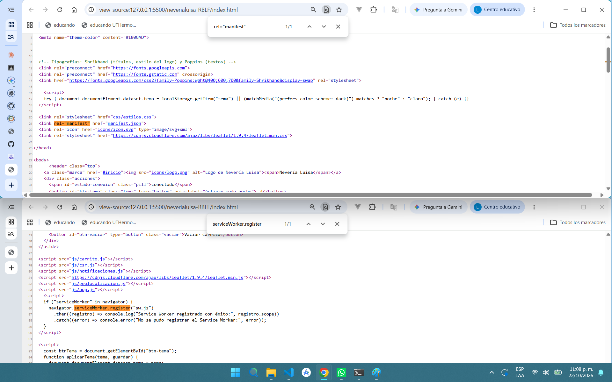
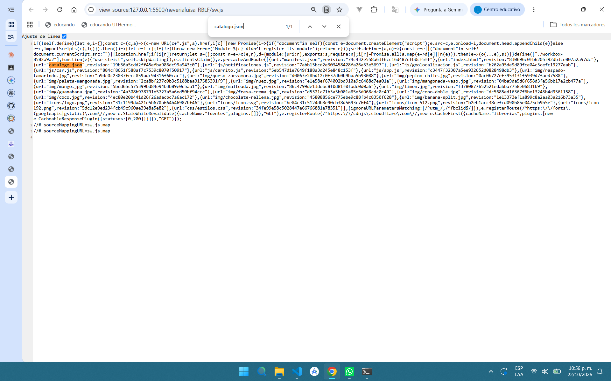
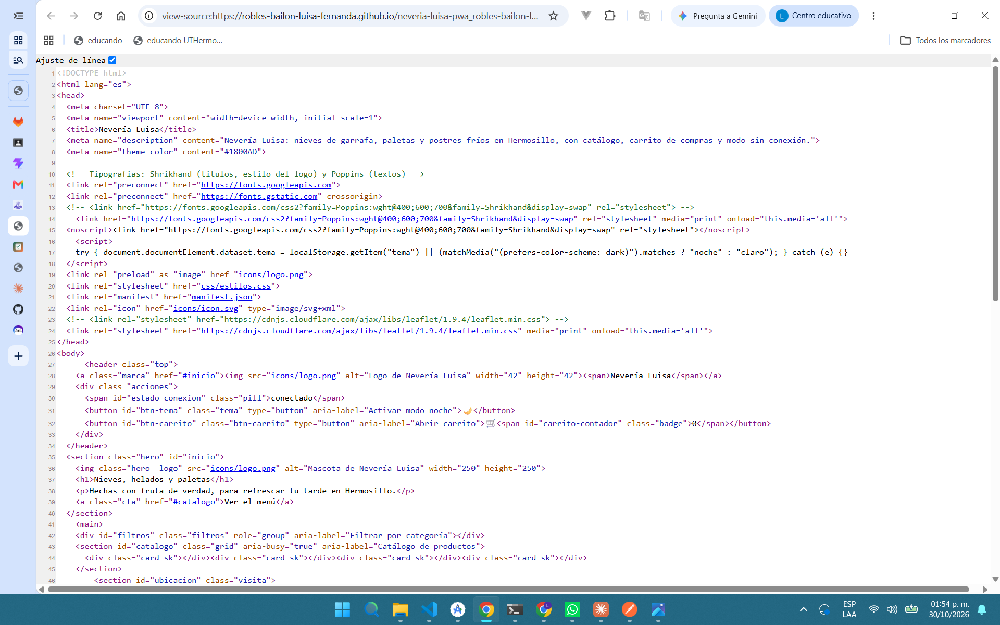
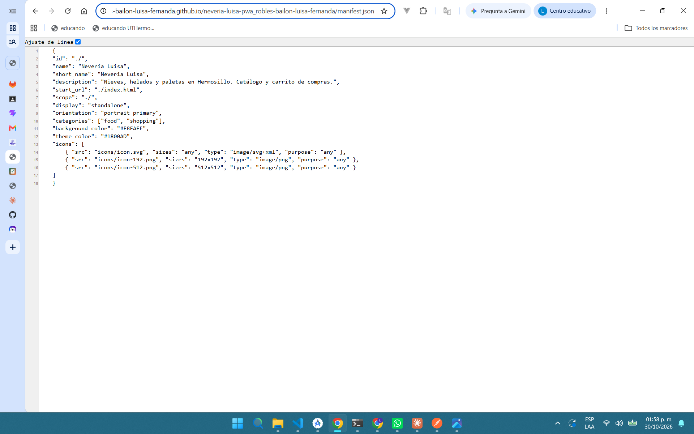
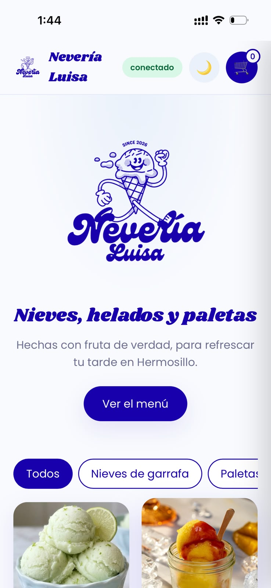

# Nevería Luisa — PWA de ventas

| Dato | Valor |
|---|---|
| **Alumno** | ROBLES BAILON LUISA FERNANDA |
| **Grupo** | ING10-1 |
| **Negocio · giro** | Nevería Luisa · Nevería y paletería: nieves de garrafa, paletas de agua y de leche y postres fríos; ideal para el calor de Hermosillo. |
| **URL del repositorio** | https://github.com/ROBLES-BAILON-LUISA-FERNANDA/neveria-luisa-pwa_robles-bailon-luisa-fernanda |
| **URL de GitHub Pages** | https://robles-bailon-luisa-fernanda.github.io/neveria-luisa-pwa_robles-bailon-luisa-fernanda/ |  

## Historial de avances

| Avance | Hash del commit entregado | Fecha |
|---|---|---|
| 1 | 66010b54a5043d689bdf1be0bde1ac4adce8b5b1 | 11/10/2026 |
| 2 | 8b3b6accfa4f6dafc9afa2c65fa2f40ab39bf834 | 18/10/2026 |
| 3 | ac2f710746c1cd5be8d3f4b7f6ca1c9474d01438 | 25/10/2026 |
| 4 | (se escribe en el reporte PDF) | 01/11/2026 |

## Guía de instalación

### ¿Qué es esta app?
Nevería Luisa es una aplicación que sirve para ver el menú de mi nevería, con 15 productos en tres categorías (nieves de garrafa, paletas y especiales), armar un pedido en el carrito y saber qué tan lejos estoy del local. Se puede instalar en el celular o la computadora como si fuera una app normal, y sigue abriendo aunque no haya internet.

### Cómo abrirla
Entra desde cualquier navegador a esta dirección:
https://robles-bailon-luisa-fernanda.github.io/neveria-luisa-pwa_robles-bailon-luisa-fernanda/

Se abre la página de inicio con el logo y el catálogo de productos.

### Cómo instalarla

**En iPhone (Safari):**
1. Abre la dirección de arriba en **Safari**, porque en iPhone otros navegadores no permiten instalarla.
2. Toca el botón **Compartir** (el cuadro con una flecha hacia arriba).
3. Elige **Agregar a inicio** y toca **Agregar**.
4. Aparece el ícono de Nevería Luisa en la pantalla de inicio. Ábrela desde ahí y se ve en pantalla completa, sin la barra del navegador.

**En Android (Chrome):**
1. Abre la dirección en **Chrome**.
2. Toca el menú de los tres puntos (⋮).
3. Elige **Instalar app** (o **Agregar a la pantalla principal**) y confirma con **Instalar**.
4. Abre la app desde el ícono que quedó en tu pantalla.

**En la computadora (Chrome o Edge):**
1. Abre la dirección en el navegador.
2. En la barra de direcciones, a la derecha, hay un ícono que es como un monitor con una flecha hacia abajo que es para instalarla. Haz clic en él.
3. Confirma con **Instalar**. La app se abre en su propia ventana y queda en tu escritorio o menú de inicio.

### Cómo usarla
- **Ver el menú:** en la página de inicio toca el botón **Ver el menú**, o baja hasta las tarjetas. Ahí encontrarás cada una con foto, nombre y precio.
- **Filtrar:** arriba de las tarjetas están los botones **Todos**, **Nieves de garrafa**, **Paletas** y **Especiales**. Al tocar uno, solo se muestran los productos de esa categoría.
- **Agregar al carrito:** toca el botón **+** de la tarjeta del producto que desees agregar. El número del carrito sube cada que agregas un producto.
- **Revisar el pedido:** toca el carrito que está arriba a la derecha. Ahí puedes subir o bajar la cantidad con **+** y **−**, quitar un producto con **✕**, vaciar todo con el botón **Vaciar carrito** y ver el **Total**. El carrito se guarda en el dispositivo, así que sigue ahí aunque cierres la app.
- **Sincronizar:** con **Sincronizar carrito** la app avisa que el pedido quedó enviado (de forma simulada, porque no hay un servidor real). Si no hay internet, avisa que se enviará cuando regrese la conexión.
- **Modo noche:** el botón con la Luna de arriba cambia los colores a modo oscuro, y el Sol regresa al modo claro. La app recuerda tu elección aunque la cierres y la abras después.
- **Saber cuánto falta para llegar:** en la sección **Visítanos**, toca el botón **Usar mi ubicación**, acepta el permiso y aparece un mapa con la ruta hasta la nevería, la distancia y el tiempo estimado.
- **Notificaciones:** al final de la página, toca el botón **Activar notificaciones**. Aparecerá una ventana con un aviso; acepta el permiso. A partir de ahí, la app muestra un aviso cuando agregas un producto al carrito. En iPhone puede no estar disponible, según la versión de iOS.
- **Sin internet:** la etiqueta de arriba cambia de **conectado** a **sin conexión**, pero el catálogo, las fotos y el carrito siguen funcionando. Para eso hay que abrir la app al menos una vez con internet.

## Comparación SSR vs CSR

### SSR (Django): los productos llegan escritos en el HTML

### CSR (JavaScript): el div del catálogo llega vacío

## Funciones PWA (avance 3)

### index.html: manifest y registro del Service Worker activos

### sw.js: Workbox precachea el catálogo y las fotos

## Versión publicada (avance 4)

### index.html en GitHub Pages

### manifest.json en GitHub Pages

### Mi app instalada en el celular
