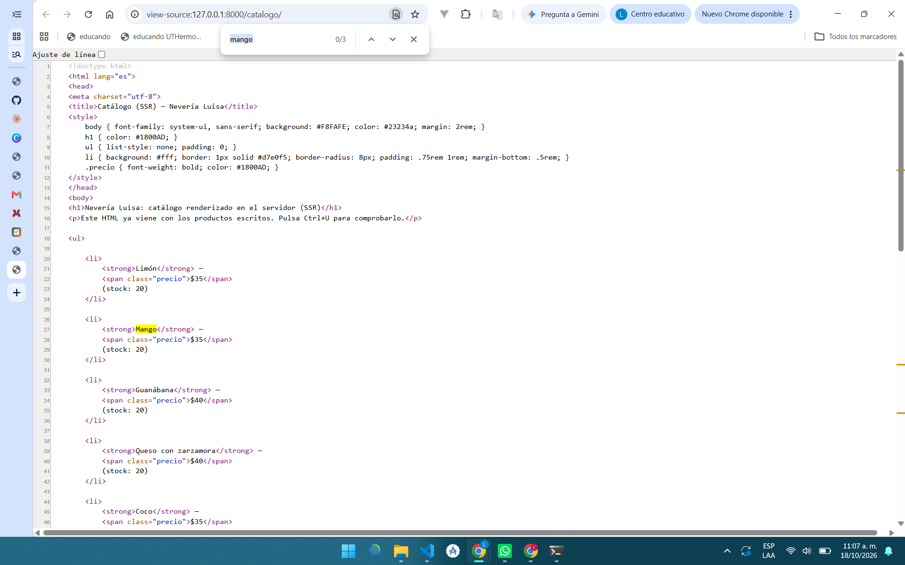
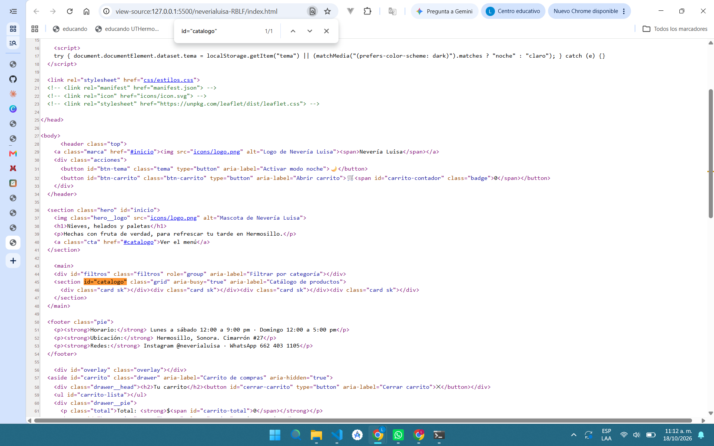

# Nevería Luisa — PWA de ventas

| Dato | Valor |
|---|---|
| **Alumno** | ROBLES BAILON LUISA FERNANDA |
| **Grupo** | ING10-1 |
| **Negocio · giro** | Nevería Luisa · Nevería y paletería: nieves de garrafa, paletas de agua y de leche y postres fríos; ideal para el calor de Hermosillo. |
| **URL del repositorio** | https://github.com/ROBLES-BAILON-LUISA-FERNANDA/neveria-luisa-pwa_robles-bailon-luisa-fernanda |
| **URL de GitHub Pages** | https://robles-bailon-luisa-fernanda.github.io/neveria-luisa-pwa_robles-bailon-luisa-fernanda/ |  

## Historial de avances

| Avance | Hash del commit entregado | Fecha |
|---|---|---|
| 1 | 66010b54a5043d689bdf1be0bde1ac4adce8b5b1 | 11/10/2026 |
| 2 | 8b3b6accfa4f6dafc9afa2c65fa2f40ab39bf834 | 18/10/2026 |
| 3 | (hash del avance 3) | 25/10/2026 |
| 4 | (se escribe en el reporte PDF) | 01/11/2026 |

## Comparación SSR vs CSR

### SSR (Django): los productos llegan escritos en el HTML

### CSR (JavaScript): el div del catálogo llega vacío

